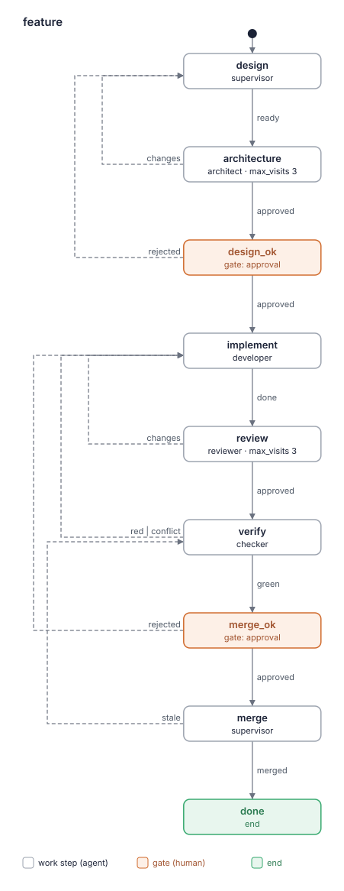

# Kit report: lado-dev 0.12.0

- Date: 2026-10-11
- Kit: the worktree of run `improve/lado-dev` (`.lado/worktrees/kit-lado-dev/improve-lado-dev`), branch `lado/kit-lado-dev/improve-lado-dev`; path given by the task
- Commit: `38324bf`
- Evaluated by: kit-builder critic (layers a and b)
- Mode: full evaluation (step `assess` of `improve`). The task's report `kit-reports/lado-dev-0.10.3-2026-10-07.md` is background only: the kit's text changed since its commit `683a227` (0.11.0–0.12.0 added the checker, `verify` and run artifacts).
- Passes: three independent sub-agents, each given `kit-rubric`, `lado-kit-format`, the kit folder, the folders of all 20 dependency skills (`lado kits show lado-dev`, "Skills:") and LADO's repository (`~/Projects/lado`, `37df0b4`) for facts. Pass 1 started from kit.yaml and the roles (its prompt carried an unfilled start placeholder; it used the rubric's pass-1 order), pass 2 from the flows, tracing later visits, red/conflict/stale and gates, pass 3 from `lado-checks` and the dependency skills. Every dependency skill was found and read. The critic merged the lists and checked each quote with `grep -nF`. 6 one-pass findings dropped, 4 kept as confirmed (F2.2, F5.3, F5.4, F6.2).

Findings are candidates for the human to weigh, not a pass/fail grade.

## Card

| Layer | Result |
|---|---|
| a. `lado kits check` | OK; 0 warnings |
| a. Budget | yellow; worker roles 4, work steps in `feature` 6, words developer 1030, reviewer 868, 5 pairs of similar paragraphs (100%, 100%, 93%, 79%, 62%); all justified in BLUEPRINT.md §4 (its words: developer 1030, reviewer 868; lead 939 there, 951 now, still green) |
| a. Flows | 2 drawn; `--compare` on BLUEPRINT.md exits 2 (its skeletons carry `produces`/`reads`, which the script rejects); with those lines stripped from a scratch copy: same as the skeletons |
| b. Rubric | 15 findings (2 high, 8 medium, 5 low); 4 of 12 criteria without findings (1, 7, 8, 11) |
| Covers | full evaluation of the whole kit, 11 files (kit.yaml, README.md, BLUEPRINT.md, 5 roles, 2 flows, 1 skill) and its 20 dependency skills |

The count covers only what the row "Covers" names: a count of a re-evaluation and one of a
full evaluation are not comparable.

### `lado kits check .`

```
lado-dev: OK (4 agents, 20 skills, 4 packs and 2 flows)
```

Expects: none (no `expects …` lines; `kit.yaml` has no `expects`).

Read-only: none (no `read-only roles: …` line); `dependencies.lado: ">=0.27"`.

### Budget script (exit status 0)

```
# Complexity budget: lado-dev 0.12.0

| Measure | Where | Value | Green / yellow up to | Zone |
|---|---|---|---|---|
| Worker roles (not supervisor) | kit | 4 | 3 / 5 | yellow |
| Work steps in a flow | flows/feature.yaml | 6 | 5 / 8 | yellow |
| Work steps in a flow | flows/fix.yaml | 4 | 5 / 8 | green |
| Gates in a flow | flows/feature.yaml | 2 | 2 / 3 | green |
| Gates in a flow | flows/fix.yaml | 1 | 2 / 3 | green |
| Words in a role prompt | agents/architect.md | 587 | 800 / 1500 | green |
| Words in a role prompt | agents/checker.md | 660 | 800 / 1500 | green |
| Words in a role prompt | agents/developer.md | 1030 | 800 / 1500 | yellow |
| Words in a role prompt | agents/reviewer.md | 868 | 800 / 1500 | yellow |
| Words in the lead's prompt | agents/supervisor.md | 951 | 1000 / 1500 | green |
| Own skills | kit | 1 | 5 / 10 | green |
| MCP servers | kit | 0 | 2 / 4 | green |

## Similar paragraphs (one rule, one place; 55% similar or more)

- yellow: 100% similar: flows/feature.yaml: state "verify": "Check the branch as your role describes, and write the commit you checked, ea..." ~ flows/fix.yaml: state "verify": "Check the branch as your role describes, and write the commit you checked, ea..."
- yellow: 100% similar: flows/feature.yaml: state "merge": "Follow `lado-checks`, "Merging a run's branch": the **Found on the way** item..." ~ flows/fix.yaml: state "merge": "Follow `lado-checks`, "Merging a run's branch": the **Found on the way** item..."
- yellow: 93% similar: flows/feature.yaml: state "review": "Review the run's branch against main, read-only, as your role describes: the ..." ~ flows/fix.yaml: state "review": "Review the run's branch against main, read-only, as your role describes: the ..."
- yellow: 79% similar: flows/feature.yaml: state "implement": "Implement the design (your `design` input, as the human approved it; read it ..." ~ flows/fix.yaml: state "implement": "Implement the task in the run's worktree, test-first, as your role describes...."
- yellow: 62% similar: agents/architect.md: "Most reviews come as a step of a flow run (a message from `lado`): the design..." ~ agents/reviewer.md: "Most reviews come as a step of a flow run (a message from `lado`): the step s..."

Overall: yellow
```

### Flows




```
$ flow_diagram.py . --compare BLUEPRINT.md
error: BLUEPRINT.md:80: state 'design': a skeleton holds only agent, gate, end, outcomes, max_visits (not produces) (exit status 2)

$ flow_diagram.py . --compare <scratch copy of BLUEPRINT.md without its produces:/reads: lines>
same as the plan in <scratch>/BLUEPRINT-stripped.md (exit status 0)
```

The first failure is the script's, not the kit's: BLUEPRINT.md's skeletons add `produces`
and `reads` (R12), which the skeleton format of kit-builder does not know yet ("Found on the
way"). States, agents, gates, outcomes and `max_visits` agree.

## Fix first

1. `merge`: give a failed `git merge --ff-only` other than "main moved" its own path (environment: show the human, leave the step open), so it is never reported `stale` (F3.2).
2. "Releasing LADO": take LADO's release order from AGENTS.md (Windows probe, CHANGELOG date), or point to it — the brief's AC-3 (F5.1).
3. `implement`: add `review` (and `architecture-review` in `feature`) to `reads` (F2.1).
4. `verify`: give the `do` (or the checker's role) a done condition and the outcome conditions (F3.1).
5. Set `read_only: true` on `architect` and `reviewer`, or record why not (F12.1).

## Findings

### 1. Role boundaries

No finding. Each role states its rights: "You do not write code; you design, delegate, decide and merge." (`agents/supervisor.md:11`); "the only write you make in the repository is a clean merge commit of main on the run's branch" (`agents/checker.md:10-11`); "Only the developer fixes; a reviewer and the checker report the class" (`skills/lado-checks/SKILL.md:79`). Who writes BACKLOG.md entries is in one place (`lado-checks`, "Who writes the entry").

### 2. Handoffs between steps

- **F2.1** [medium] `flows/feature.yaml:70` (state `implement`; also `flows/fix.yaml:11` `    reads: [verify]`)
  > `    reads: [design, verify]`
  The `do` sends the developer to `architecture-review` (feature :76) and, on a later visit after `review: changes`, to "review findings (the `review` artifact)" (feature :80, fix :16), but neither is in `reads`, while `verify`, produced later too, is. The findings to fix reach the step only through prose, so whether the developer reads them varies from run to run.
  Fix: `reads: [design, architecture-review, review, verify]` in `feature.implement`, `reads: [review, verify]` in `fix.implement`, and the same in BLUEPRINT.md's skeletons. Passes: 3/3

- **F2.2** [medium] `agents/reviewer.md:33`
  > `` `verify`). Check that the developer's report lists its role's commands (section 5) for ``
  The reviewer must check the report against the developer's role file, which is kit text, not a file of the repository it reviews, and nothing gives it a path (no `${KIT_DIR}` anywhere in the kit). The reviewer guesses the list, so a missing check is caught on some runs and not on others.
  Fix: move the developer's command list into `lado-checks` and point both roles there, or restate it in short in the reviewer's §1. Passes: 1/3, confirmed (`grep -rn KIT_DIR agents flows skills` prints nothing; the list exists only at `agents/developer.md:75-85`).

### 3. Done and outcomes

- **F3.1** [medium] `flows/feature.yaml:114` (state `verify`; the same text at `flows/fix.yaml:49`)
  > `      Check the branch as your role describes, and write the commit you checked, each`
  The `do` has no done condition and no condition for `green`, `red` or `conflict`, and the role hands that back to the step: "In a run, the `verify` step (a message from `lado`) says when you are done; this role" (`agents/checker.md:13`). Each points to the other.
  Fix: add to the `do` "Done when `verify` is written; report `green`, `red` or `conflict` as your role, section 4, says", or let `checker.md:13` say the role holds both. Passes: 3/3

- **F3.2** [high] `skills/lado-checks/SKILL.md:70` (state `merge`; known hole 1)
  > ``2. In your repo, on main, `git merge --ff-only <the run's branch>`. If it fails because``
  Only "main moved" is classified (→ `stale`). A refusal because the supervisor's checkout has local changes or is on another branch has no rule, and `stale` is the only other outcome: the run goes to `verify`, which finds nothing new, `merge_ok` asks again, the merge fails again — a loop that costs a full `make check` and a human approval each round.
  Fix: "Any other failure (local changes, another branch checked out) is no outcome: show the human the command and its output, retry once they say it is settled; never stash or reset their checkout" (`lado-kit-format`, "When a check or command fails"). Passes: 3/3 (impact high in pass 2, medium in passes 1 and 3; the higher is taken)

### 4. Independent verification

- **F4.1** [medium] `flows/feature.yaml:120` (gate `merge_ok`; also `flows/fix.yaml:55`)
  > `    reads: [report, verify]`
  The human approves the merge, the step hard to undo, with the author's report and the checker's results but not the independent `review`: the Minor findings a "Yes" leaves open and its **Found on the way** items are not shown, and the note that reaches the gate is the checker's.
  Fix: `reads: [report, review, verify]` in both flows and the skeletons. Passes: 3/3

- **F4.2** [low] `flows/feature.yaml:65` (gate `design_ok`)
  > `    reads: [design]`
  The human approves the design seeing only the architect's counts in the note; its open Minor findings are in `architecture-review`, which the gate does not show.
  Fix: `reads: [design, architecture-review]`. Passes: 3/3

### 5. Contradictions

- **F5.1** [high] `skills/lado-checks/SKILL.md:51`
  > ``the version bump (`uv version <X.Y.Z>`, commit). Then, in this order: push main; wait for``
  The supervisor releases "in the order `lado-checks` gives" (`agents/supervisor.md:79-80`), and that order disagrees with LADO's AGENTS.md, which the supervisor holds as "the standard every change is held to": AGENTS.md:198-204 requires "Run the Windows probe on it (`gh workflow run windows-shell.yml --ref main -f runner=windows-latest` …) and wait for it to be green", and AGENTS.md:205-206 that "the release commit puts the date in its place" in CHANGELOG.md. Pushing the tag publishes to PyPI, so a release can ship without the probe and with an undated CHANGELOG.
  Fix: the brief's AC-3 order, plus the CHANGELOG date in the version commit; or point to AGENTS.md "Release" as the one source. The probe starts a CI run on GitHub: say whether it needs the human's yes (question 2). Passes: 2/3 (medium in pass 1, high in pass 2; the higher is taken)

- **F5.2** [medium] `skills/lado-checks/SKILL.md:22`
  > ``` `pyproject.toml` sets `addopts = -m 'not integration and not live and not ui'`, so a test ```
  Stale: LADO's `pyproject.toml:63` is `addopts = "-m 'not integration and not live and not smoke and not ui'"`, and the folder list that follows has no `tests/smoke/`. An agent running a smoke file without `-m smoke` gets the silent drop this paragraph warns about, and no role names `make test-smoke`, which AGENTS.md's layer 5 says is "Needed for a change in how LADO starts, configures or talks to a CLI".
  Fix: add `smoke` to the quote and "`tests/smoke/` `-m smoke`" to the list, or point to `pyproject.toml` instead of copying it; whether the checker or the developer runs `make test-smoke` for provider changes is question 3. Passes: 3/3 (criterion 5 in pass 1, 4 in pass 3, 9 in pass 2; criterion 5 taken, as the fix makes the skill agree with LADO)

- **F5.3** [medium] `skills/lado-checks/SKILL.md:36`
  > ``CLIs and models, serially. They run only in `verify` (the checker's role says when) and at``
  Contradicts `agents/developer.md:77` "also a failing live test (`uv run pytest -m live -n0 <file>::<test> -k <provider>`; a": after a `red` from `verify`, one developer follows the skill and does not rerun the live test, another its role and does. This task (live tests only at a release) has to settle both places at once.
  Fix: one rule in `lado-checks` for who runs live tests when, the developer's rerun included or removed; the role points to it. Passes: 1/3, confirmed (both lines as quoted; `grep -rn live agents flows skills`).

- **F5.4** [low] `skills/lado-checks/SKILL.md:27`
  > ``and add `-n auto` to every unit, integration and UI pytest command: the Makefile passes it,``
  The checker's reruns use `-n0` (`agents/checker.md:32` "`-m integration`, ui `-m ui`) and `-n0`, e.g."): two rules for the same command.
  Fix: "…to every suite or whole-file command; a rerun of single node ids uses `-n0`". Passes: 1/3, confirmed (both lines as quoted).

### 6. Duplication

The five pairs the budget script lists are justified in BLUEPRINT.md §4 (the human's decision to keep `feature` and `fix` as two flows whose `do`s read on their own).

- **F6.1** [low] `flows/feature.yaml:90` (state `implement`; also `flows/fix.yaml:26`)
  > `      one-line result; note_body is short: what changed since the last visit, your`
  The note format of `implement` is written out in both `do`s and in `agents/developer.md:90` "(what changed since the last visit, your concerns and questions for the human, or that"; three copies of one rule.
  Fix: keep it in the role; the `do`s say "Report `done` as your role, section 5, says". Passes: 2/3

- **F6.2** [low] `agents/checker.md:56`
  > `When the human declined Claude's run, or a live provider was skipped for an environment`
  The same rule is in `skills/lado-checks/SKILL.md:40-41` "a provider the human declined, or one skipped for an environment cause (its CLI missing or". This task changes exactly that rule, so both copies must change together or drift.
  Fix: one place (the checker's §4), a pointer from `lado-checks`. Passes: 1/3, confirmed (both lines as quoted).

### 7. When to call the human

No finding. Workers go through the lead: "Do not write to `human` or use `ask_human`; a question for the human goes to the" (`agents/developer.md:117`, likewise reviewer, checker, architect); "A worker's NEEDS_CONTEXT, BLOCKED or environment message leaves its step open" (`agents/supervisor.md:86`); "After three failed fix attempts, stop and report BLOCKED" (`agents/developer.md:63`); "A step at its visit limit opens a gate" (`agents/supervisor.md:92`).

### 8. Loops on a later visit

No finding. `architecture` and `review` have `max_visits: 3`, produce their own review and mark findings RESOLVED or STILL OPEN (`flows/feature.yaml:55-56`, `:104-105`); `design` revises its artifact, "not one from memory" (`:36`); `implement` writes its report whole, "starting with every AC, written out in full" (`:88`); `verify` writes `verify` "For every outcome" (`agents/checker.md:62`); `stale` is bounded by the `merge_ok` gate.

### 9. Concision and why

- **F9.1** [low] `agents/checker.md:71` (also `agents/developer.md:91` and `:70-71`)
  > ``is none. Outside a run, send the results to the supervisor with `send_message`. Do not``
  Outside a flow the supervisor allows "only read-only work" (`agents/supervisor.md:70`) and "Any code goes through `fix` or `feature`"; a checker (which commits a merge) or a developer outside a run cannot happen, so these branches are dead text that invite the work §3 forbids.
  Fix: delete the "Outside a run" sentences of the checker and the developer. Passes: 2/3 (criterion 5 in pass 1, 9 in pass 3; 9 taken, the fix is a deletion)

The rest carries its reasons ("since a rebase rewrites commits the review relies on", `agents/developer.md:28`); the two yellow role prompts are justified in BLUEPRINT.md §4.

### 10. Skill descriptions

- **F10.1** [medium] `kit.yaml:13` (known hole 6a)
  > `  lado: ">=0.27"`
  The roles always run `git` (`git merge main`, `git diff main...HEAD`, `--ff-only`) and, on the LADO repository the kit exists for, `make` and `uv` (`make lint` in every review, `uv run pytest`, `uv version`), yet `kit.yaml` has no `expects.commands`; a machine without one starts the session and fails halfway through a step. After this task's AC-3 the release also always runs `gh`.
  Fix: `expects: {commands: [git, make, uv]}` (and `gh` if the human counts the release as every project's, question 4), `dependencies.lado: ">=0.30"` (">=0.34" with F12.1), and the README lists them as required. Passes: 2/3 (low in pass 1, medium in pass 2; pass 3 judged it handled since a kit's own repository has no Makefile; the higher is taken)

`lado-checks`' description says what it holds, when to use it and how it differs from `verification-before-completion` and `diagnosing-bugs`; every listed skill is used and declared by its own folder.

### 11. Provider neutrality

No finding. No CLI's tool names, slash commands, models or config files: "Change files with your editing tools (edit, write)" (`agents/developer.md:24`); only LADO's tools are named; "Claude" appears only as a `PROVIDER` value of LADO's live tests. No kit file is reached by path.

### 12. Safety and scope

- **F12.1** [medium] `agents/reviewer.md:19` (also `agents/architect.md:10` "task? You change no files.")
  > `You change no files: no fixes, no commits on the branch you review.`
  The reviewer and the architect only read, run `make lint` and report through artifacts and notes, yet neither has `read_only: true`: only the prose keeps them from editing — the reviewer works in the very worktree it reviews — and LADO does not tell the lead when the tree changed in their turns. `skills/lado-checks/SKILL.md:123` also calls the checker one of "the read-only roles (architect, reviewer, checker)", though it commits a merge.
  Fix: `read_only: true` on `architect` and `reviewer`, `dependencies.lado: ">=0.34"`, a README line that the kit then does not run on Codex CLI, "role (read-only)" in BLUEPRINT.md §3; or, if reviewers must run on Codex, that trade-off in the blueprint (question 1). Either way `lado-checks:123` names the checker apart. Passes: 3/3

Merges, pushes and tags have a gate or a yes: "every merge into main has a review and the human's `merge_ok`" (`agents/supervisor.md:72-73`); "Each push needs the human's yes." (`skills/lado-checks/SKILL.md:58-59`).

## Known holes

| Known hole | Finding, or how the kit handles it |
|---|---|
| 1. Red check sent back with no environment cause considered | Checks: "**environment**: tmux, node, uv, a CLI login, a network or disk problem. Report what is" (`lado-checks:92`), "the reviewer and the checker tell the supervisor and leave the step open" (`:94-95`), checker §4. Open for the merge step: **F3.2**. |
| 2. Work outside a flow, merge without a gate | "Any code goes through `fix` or `feature`, so every merge into main has a review and the" (`supervisor.md:72`); merge only after `merge_ok`. Dead outside-a-run branches: **F9.1**. |
| 3. Path outside the run's worktree | Handled: "Work only inside your worktree (in a run, the run's worktree)." (`developer.md:23`); logs "outside the tree" (`lado-checks:44`); the BACKLOG.md commit goes "in the run's worktree" (`:68`), the `--ff-only` "In your repo, on main" on purpose. |
| 4. Verdict without a severity threshold | "The answer is Yes when no Critical or Important finding is open; Minor ones do not block" (`reviewer.md:85-86`); architect: "`approved` when no Critical or Important finding and no question for the human is left" (`feature.yaml:58-59`). |
| 5. Dependency skill that writes or asks where its role must not | Handled: `tdd`'s confirmations by "pick them yourself and list them in your report, without asking the human" (`developer.md:36-37`); `frontend-design` by "do not redesign or ask the human for a look" (`:50`); asks of `diagnosing-bugs` and `receiving-code-review` by "a question for the human goes to the supervisor" (`:117-118`); the reviewer's and architect's skills write nothing. |
| 6. Commands out of step with `expects.commands` | (a) **F10.1**; (b) not applicable (no `expects.commands`); (c) not applicable. |
| 7. Read-only roles out of step with what they do | (a) **F12.1** (architect, reviewer); (b), (c), (d) not applicable: no role has `read_only`. |

## Not traced

None: every role, step, gate and skill has a row in BLUEPRINT.md §3 and a requirement; each yellow measure has its reason in §4 (§4's lead count, 939, is now 951, still green). The flows agree with the skeletons in states, agents, gates, outcomes and `max_visits`; `--compare` could not read the skeletons' `produces`/`reads` (see "Flows"), so those two keys were compared by reading: they agree.

## Questions for the human

1. Read-only reviewer and architect (F12.1): set `read_only: true` and give up Codex CLI for these roles, or keep them writable and record why in the blueprint? Recommended: `read_only: true`; the kit runs its reviewers on Claude today, and the reviewer works in the worktree it reviews.
2. The Windows probe at a release (F5.1, brief AC-3) starts a GitHub Actions run: does it need the human's yes like each push, or is it covered by the yes to push main? Recommended: covered by that yes, said in one line.
3. Smoke tests (F5.2): with live tests leaving `verify`, should `verify` run `make test-smoke PROVIDER=<name>` (no paid model) for provider changes, or is CI's smoke job on push enough? Recommended: CI is enough; fix only the stale `addopts` quote. This is outside the brief's scope unless you add it.
4. `expects.commands` (F10.1): list `git`, `make`, `uv` (and `gh`, used only at a release)? Recommended: `git`, `make`, `uv`; `gh` stays out, as only the release needs it.

## Found on the way

- [kit-builder] `kit-budget`'s `flow_diagram.py --compare` rejects `produces` and `reads` in a blueprint's flow skeleton ("a skeleton holds only agent, gate, end, outcomes, max_visits (not produces)"), though LADO 0.27 flows carry them; a blueprint that records them, as lado-dev's R12 does, cannot be compared. Wanted: the skeleton format accepts and compares both keys.
- LADO's AGENTS.md contradicts itself on live tests: :163 "they run locally, at release only", :1446-1447 "run locally at release, every provider (Claude Code with the human's yes), and a provider's after changing it". The brief already plans to drop the second half after the tag.
