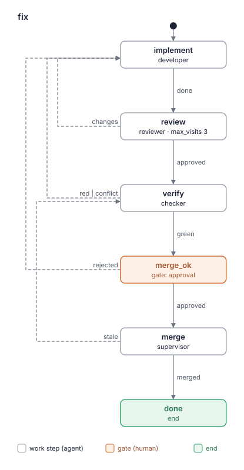

# Kit report: lado-dev 0.13.0

- Date: 2026-10-11
- Kit: the worktree of run `improve/lado-dev` (`.lado/worktrees/kit-lado-dev/improve-lado-dev`), branch `lado/kit-lado-dev/improve-lado-dev`; path given by the task
- Commit: `0d03829`
- Evaluated by: kit-builder critic (layers a and b)
- Mode: re-evaluation, visit 1 of step `evaluate` in `improve`, verdict asked. Previous report: `kit-reports/lado-dev-0.12.0-2026-10-11.md` (the `assessment`). The plan names its commit `38324bf`, which is the base. Change: `git diff 38324bf -- kit.yaml README.md BLUEPRINT.md agents flows skills` touches all 11 files of the kit's text (137 insertions, 120 deletions).
- Passes: three independent sub-agents went over the changed text and its surroundings, each with `kit-rubric`, `lado-kit-format`, the kit, the diff, the goal of the brief and LADO's repository (`~/Projects/lado`) for facts. Pass 1 started from kit.yaml and the roles. Pass 2 started from the flows and traced scenarios: a provider change merged without live tests, each release step going red, a flaky live test, a no to Claude, a mid-run request for live tests, a failed `--ff-only`, and the read-only reviewer's `make lint`. Pass 3 started from `lado-checks` against LADO's AGENTS.md, Makefile, pyproject.toml and workflows. The critic did the cut-rule check from the diff and the author's table. A fourth sub-agent made the full pass (Re-evaluation 5) over the whole of every file, which here is the whole kit. The critic checked each quote with `grep -nF`. 2 one-pass findings were dropped; 1 full-pass finding was kept as confirmed (F10.2).

Findings are candidates for the human to weigh, not a pass/fail grade.

## Card

| Layer | Result |
|---|---|
| a. `lado kits check` | OK; 0 warnings; with `--tag v0.13.0` also OK |
| a. Budget | yellow. Worker roles 4, work steps in `feature` 6, developer 963 words, reviewer 899 words, 5 pairs of similar paragraphs (100%, 100%, 93%, 74%, 62%). All are justified in BLUEPRINT.md §4; the lead has 947 words (green). |
| a. Flows | 2 drawn. `--compare BLUEPRINT.md` exits 2 on the skeletons' `produces`/`reads` (kit-builder's script, see "Found on the way"). On a copy without those lines: same as the skeletons. `produces`/`reads` compared by reading: they agree. |
| b. Rubric | 10 findings in the changed text (0 high, 6 medium, 4 low), plus 1 under "Missed earlier" (low). 7 of 12 criteria have no finding in the changed text (1, 2, 4, 7, 8, 9, 11). All 15 findings of the 0.12.0 report are RESOLVED. |
| Covers | re-evaluation of the changed text, with a full pass over the 11 files the diff touches |
| Stop rule | not met: 6 medium in the changed text. This is advice for the release gate, not a block. |

The count covers only what the row "Covers" names: a count of a re-evaluation and one of a
full evaluation are not comparable.

### `lado kits check .`

```
lado-dev: OK (4 agents, 20 skills, 4 packs and 2 flows)
read-only roles: architect, reviewer
expects commands: git, make, uv
```

`lado kits check . --tag v0.13.0` printed the same three lines (exit 0).

Expects: `expects commands: git, make, uv`, with no warning.

Read-only: `read-only roles: architect, reviewer`; `dependencies.lado: ">=0.34"` (checked by hand: that is the version `read_only` needs).

### Budget script (exit status 0)

```
# Complexity budget: lado-dev 0.13.0

| Measure | Where | Value | Green / yellow up to | Zone |
|---|---|---|---|---|
| Worker roles (not supervisor) | kit | 4 | 3 / 5 | yellow |
| Work steps in a flow | flows/feature.yaml | 6 | 5 / 8 | yellow |
| Work steps in a flow | flows/fix.yaml | 4 | 5 / 8 | green |
| Gates in a flow | flows/feature.yaml | 2 | 2 / 3 | green |
| Gates in a flow | flows/fix.yaml | 1 | 2 / 3 | green |
| Words in a role prompt | agents/architect.md | 587 | 800 / 1500 | green |
| Words in a role prompt | agents/checker.md | 555 | 800 / 1500 | green |
| Words in a role prompt | agents/developer.md | 963 | 800 / 1500 | yellow |
| Words in a role prompt | agents/reviewer.md | 899 | 800 / 1500 | yellow |
| Words in the lead's prompt | agents/supervisor.md | 947 | 1000 / 1500 | green |
| Own skills | kit | 1 | 5 / 10 | green |
| MCP servers | kit | 0 | 2 / 4 | green |

## Similar paragraphs (one rule, one place; 55% similar or more)

- yellow: 100% similar: flows/feature.yaml: state "verify": "Check the branch as your role describes. On a later visit your previous resul..." ~ flows/fix.yaml: state "verify": "Check the branch as your role describes. On a later visit your previous resul..."
- yellow: 100% similar: flows/feature.yaml: state "merge": "Follow `lado-checks`, "Merging a run's branch": the **Found on the way** item..." ~ flows/fix.yaml: state "merge": "Follow `lado-checks`, "Merging a run's branch": the **Found on the way** item..."
- yellow: 93% similar: flows/feature.yaml: state "review": "Review the run's branch against main, read-only, as your role describes: the ..." ~ flows/fix.yaml: state "review": "Review the run's branch against main, read-only, as your role describes: the ..."
- yellow: 74% similar: flows/feature.yaml: state "implement": "Implement the design (your `design` input, as the human approved it; read it ..." ~ flows/fix.yaml: state "implement": "Implement the task in the run's worktree, test-first, as your role describes...."
- yellow: 62% similar: agents/architect.md: "Most reviews come as a step of a flow run (a message from `lado`): the design..." ~ agents/reviewer.md: "Most reviews come as a step of a flow run (a message from `lado`): the step s..."

Overall: yellow
```

### Flows




```
$ flow_diagram.py . --compare BLUEPRINT.md
error: BLUEPRINT.md:90: state 'design': a skeleton holds only agent, gate, end, outcomes, max_visits (not produces) (exit status 2)

$ flow_diagram.py . --compare <scratch copy of BLUEPRINT.md without its produces:/reads: lines>
same as the plan in <scratch>/BLUEPRINT-stripped-2.md (exit status 0)
```

## Verdict

**approved.** `lado kits check` has no error. No budget measure is red, and every yellow
measure is justified in BLUEPRINT.md §4. The flows agree with the skeletons: on the stripped
copy the script finds no difference, and `produces`/`reads` agree by reading. The exit 2 on
the original blueprint comes from kit-builder's script, which does not know these two keys,
not from the kit. No high finding is open.

The stop rule is not met: 6 medium findings remain in the changed text. Most of them are
gaps the new live-test and release rules opened (F12.1, F5.1, F5.2, F5.3, F3.1). They do not
block the verdict, but the human may want one more round before the tag.

## Fix first

1. A live run the human asks for: name the tree and commit, and say where the result goes and what a red result does (F12.1).
2. The release's flaky rule forces a second commit on main, and neither the tag's nor the live tests' commit is named (F5.2, F5.4).
3. Say that a live check the developer writes and does not run is not evidence for an AC (F5.1).
4. Say that the kit's rule overrides AGENTS.md's "a provider's after changing it", so a reviewer does not raise a missing live run as a finding (F5.3).
5. Classify a red CI, probe or live result at a release before sending it to `fix` (F3.1).

## Findings

### 1. Role boundaries

No finding. The supervisor alone runs live tests ("you run them locally", `agents/supervisor.md:89`). The checker's rights are unchanged ("the only write you make in the repository is a clean merge commit of main on the run's branch", `agents/checker.md:10-11`). The architect and reviewer are now `read_only: true`.

### 2. Handoffs between steps

No finding of its own. The new `reads` are each produced by an earlier state: `design_ok` reads `architecture-review`, `implement` reads `review`/`verify`, `merge_ok` reads `review`. The checker's note about live tests reaches `merge_ok` as the note the gate shows ("a note for the human at `merge_ok`", `agents/checker.md:48-49`). Pass 1 found that a live run's result has no artifact; that is folded into F12.1.

### 3. Done and outcomes

- **F3.1** [medium] `skills/lado-checks/SKILL.md:65` (changed text; known hole 1)
  > `Red CI, probe or live tests: no tag; tell the human, quoting the failing line. The fix goes`
  A red CI, smoke or Windows probe run is sent straight to `fix`, with no step that tells a code fault from an environment one (a runner outage, a failed WSL setup in the 20–25-minute probe, a model API error). "When a check fails" names only the developer, reviewer and checker. "Releasing LADO" also has no "Done when", unlike every other section of the skill.
  Fix: "Classify it first ('When a check fails'); environment or flaky: rerun once (`gh run rerun <id> --failed` for a workflow) after telling the human; only code or test goes through `fix`." Add "Done when the tag is pushed." Passes: 3/3 (low in pass 1, medium in passes 2 and 3; the higher is taken)

- **F3.2** [low] `skills/lado-checks/SKILL.md:66` (changed text)
  > ``through `fix`, then the release goes on from step 2 with the same version.``
  Step 1 has already replaced "(unreleased)" in CHANGELOG.md with the date. A `fix` run during a red release has no place for its line: AGENTS.md:205 says lines go "under `## X.Y.Z (unreleased)`". The date may also be stale by the time of the tag.
  Fix: "the fix's CHANGELOG line goes under the dated `## X.Y.Z`; it updates the date if the day changed." Passes: 2/3 (criterion 5 in pass 1, 7 in pass 2; 3 is taken, since the fix says how to go on)

### 4. Independent verification

No finding. The human sees a provider change merged without live tests: "your `green` note says that no live tests ran and which of those paths changed" (`agents/checker.md:48`). `merge_ok` now reads `[report, review, verify]`. At a release, CI, the probe, the live tests and the human's yes all come before the tag.

### 5. Contradictions

- **F5.1** [medium] `agents/developer.md:45` (changed text)
  > `report why it is not worth it; you write the check, the live tests run at a release.`
  The developer writes a live check it may never run. That conflicts with its own done condition at `:41` ("Done when every AC about behaviour is covered by a test you saw fail and then pass."), with `tdd`'s "Red before green" and with `verification-before-completion`. Some developers will run the check anyway, against "No role runs them in a run". Others will merge a live test nobody has run, which then fails only at release step 5, after main is pushed.
  Fix: say that a new or changed live check is the one exception to "seen failing" and is no evidence for an AC, and that the report lists it as "written, not run" so the human can ask for a run at `merge_ok`. Optionally add `uv run pytest -m live --collect-only <file>` (no model is called). Passes: 3/3

- **F5.2** [medium] `skills/lado-checks/SKILL.md:52` (changed text)
  > `   one commit on main, the only direct commit the request allows.`
  Release step 5 reruns a failed live test "as 'When a check fails' says for flaky" (`:59`). That rule says "record it in BACKLOG.md" (`:99`), and "Outside a run, the supervisor adds them on main." (`:142`). So a flaky live test at a release needs a second direct commit on main, which step 1 forbids. Committed anyway, it moves main past the commit that CI and the probe checked, and step 6 ("6. Push the tag `vX.Y.Z`, with the human's yes; it publishes to PyPI.") does not say which commit gets the tag.
  Fix: a BACKLOG.md entry found during a release is committed after the tag is pushed. Step 6 tags the release commit of step 1 (`git tag vX.Y.Z <that commit>`). Passes: 3/3

- **F5.3** [medium] `skills/lado-checks/SKILL.md:37` (changed text)
  > `CLIs and models, serially. They run only at a release ("Releasing LADO") or when the human`
  This conflicts with LADO's AGENTS.md:1446-1447, which says live tests run "locally at release, every provider (Claude Code with the human's yes), and a provider's after changing it". The reviewer is told "2. Read AGENTS.md: Testing, Design principles, Rules (including clean-room)." (`agents/reviewer.md:32`) and judges Standards against it, so it may raise a missing live run as Important. The developer may not run one, so the review loops until `max_visits`. The human's answer that smoke tests are left to CI (plan, "Answers") is also nowhere in the kit or blueprint.
  Fix: one sentence in this paragraph: in this kit's runs, this rule replaces AGENTS.md's "a provider's after changing it" (the human, 2026-10-10), and a missing live run is not a finding. Record the smoke answer in R8. The brief's "After the tag" already plans to fix AGENTS.md. Passes: 2/3 (passes 2 and 3; also the full pass)

- **F5.4** [low] `skills/lado-checks/SKILL.md:58` (changed text; cut-rule check)
  > ``5. `make test-live` locally for every provider, Claude with the human's yes; rerun a``
  The removed line "The tag needs green CI and green live tests on that commit." (`skills/lado-checks/SKILL.md:54` at `38324bf`) tied the live tests to the release commit. Step 5 now says only "locally", while AGENTS.md:1454-1457 says "on main at the release commit … locally `make test-live` passes". A supervisor may run the tests on a checkout that is not the release commit.
  Fix: "locally on main at the release commit". Passes: cut-rule check (also pass 3)

### 6. Duplication

The five pairs the budget script lists are justified in BLUEPRINT.md §4.

- **F6.1** [low] `agents/reviewer.md:37` (changed text; also `:35`)
  > ``   `make web` when their paths changed; for docs-only changes `make lint` alone. A``
  The reviewer's short copy of the developer's list (the fix for the old F2.2) has already drifted from `agents/developer.md` §5. It does not name "their paths" (`src/lado/providers/opencode_plugin.js`, `tests/js/`, `web/`). "docs-only" is not the developer's list of files (BACKLOG.md, ROADMAP.md, README.md, AGENTS.md, CLAUDE.md, `docs/`). "each integration/UI test file it changed" drops "added". It also requires "the test files it worked on" green on the reviewed commit, though the developer runs those only "While you work". So the reviewer's Minor findings differ from run to run. BLUEPRINT.md:190 also still says "the commands each role runs are in that role's file only".
  Fix: move the developer's list into `lado-checks` once and point both roles to it (and update BLUEPRINT.md:190); or copy the paths and the "after your last change" scope word for word and drop "the test files it worked on". Passes: 3/3 (also the full pass)

### 7. When to call the human

No finding in the changed text beyond F12.1. A failed `--ff-only` for another reason goes to the human: "show the human the command and its output, and retry once they say it is settled" (`skills/lado-checks/SKILL.md:80-81`). A no to Claude at a release goes to the human: "the human decides whether to release" (`:61`).

### 8. Loops on a later visit

No finding. `verify` keeps "On a later visit your previous results are your `verify` artifact." `stale` → `verify` is bounded by `merge_ok`. `review` has `max_visits: 3`.

### 9. Concision and why

No finding in the changed text. The `implement` note format now lives only in the role, and the "outside a run" branches of the checker and developer are gone. One untouched line made stale by that removal is under "Missed earlier".

### 10. Skill descriptions

- **F10.1** [medium] `kit.yaml:13` (changed text; known hole 6a)
  > `  commands: [git, make, uv]`
  The checker runs `make check` in every `verify`, and LADO's Makefile runs `_check: lint test-js web browser`: `make test-js` runs `node`, and `make web` runs `npm ci`. So `node` and `npm` are needed every time, but `expects.commands` lacks them. A machine without Node starts the session and fails halfway through `verify`, which is the failure `expects.commands` exists to prevent. The environment rule catches it ("tmux, node, uv"), so no work is lost.
  Fix: add `node` and `npm` to `expects.commands` and to the README's list of required commands, or say in BLUEPRINT.md why they stay out. Passes: 2/3 (medium in pass 1, low in pass 3; pass 2 judged them reached only through the Makefile; the higher is taken)

- **F10.2** [low] `skills/lado-checks/SKILL.md:56` (changed text)
  > ``4. The Windows probe green: `gh workflow run windows-shell.yml --ref main -f``
  Every release now runs `gh`. Leaving it out of `expects` was the human's choice, but nothing checks for `gh` or its login before step 2 pushes main. A missing or logged-out `gh` stops the release after the push.
  Fix: in step 2, "before pushing, check `gh auth status`; if it fails, tell the human". Passes: full pass, confirmed (`gh` appears only at `:56-57`; `kit.yaml:13` lacks it)

`lado-checks`' description still covers "when you release LADO". Every listed skill is used.

### 11. Provider neutrality

No finding. The README says the read-only roles "do not run on Codex CLI" (`README.md:20`). "Claude" names only a `PROVIDER` of LADO's live tests, and `gh` appears only in a step for LADO's own GitHub repository.

### 12. Safety and scope

- **F12.1** [medium] `skills/lado-checks/SKILL.md:38` (changed text; known hole 3; also `agents/supervisor.md:89` "- Live tests run at a release and when the human asks; you run them locally")
  > `asks for them; then the supervisor runs them locally. No role runs them in a run. A run`
  The checker's `green` note at `merge_ok` says no live tests ran for a provider path. That is exactly when the human will ask for them. Three things are left unsaid:
  - **Which tree and commit.** "Locally" sends the supervisor to its own checkout on main, which does not hold the run's branch, so a green result is for the wrong code.
  - **Where the result goes.** No artifact holds it, so `merge_ok` does not show it, and a later `implement` gets no failing line.
  - **What a red result does.** There is no route back.

  "No role runs them in a run" also reads as forbidding this case.
  Fix: "When the human asks during a run: in the run's worktree (`flow_status`) at the commit `verify` checked, not while `make check` runs there; quote the command and the failing line to the human and attach the output as an artifact of the run; red means the human rejects at `merge_ok` with that line. At a release: on main at the release commit." Passes: 3/3 (pass 1 also as F2.1, no artifact; merged here)

The pushes and the tag each need the human's yes: "2. Push main, with the human's yes. That yes also covers starting the Windows probe in 4." (`skills/lado-checks/SKILL.md:53`), and step 6. The ff-only path says "Never stash or reset their checkout."

## Known holes

| Known hole | Finding, or how the kit handles it |
|---|---|
| 1. Red check sent back with no environment cause considered | Runs: "An environment failure (`lado-checks`, "When a check fails") is no outcome" (`agents/checker.md:53`). Merge: "Any other failure (local changes, another branch checked out, …) is no outcome" (`lado-checks:79-80`). Release: open, **F3.1**. |
| 2. Work outside a flow, merge without a gate | "Any code goes through `fix` or `feature`, so every merge into main has a review and the" (`supervisor.md:72`). Each push and the tag need a yes. The supervisor running live tests on request is the human's decision (R9); its gaps are **F12.1**. |
| 3. Path outside the run's worktree | **F12.1** (a live run on request names no tree). Logs still go "outside the tree"; the merge's "In your repo, on main" is intended. |
| 4. Verdict without a severity threshold | "The answer is Yes when no Critical or Important finding is open; Minor ones do not block" (`reviewer.md`, §4); the architect's in `feature.yaml:58-59`. |
| 5. Dependency skill that writes or asks where its role must not | Handled. `codebase-design` on the read-only architect and the `critique-*` skills on the read-only reviewer write nothing. The developer's skills that ask the user are covered by "a question for the human goes to the supervisor" (`developer.md:114-115`). |
| 6. Commands out of step with `expects.commands` | (a) **F10.1** (`node`, `npm`). `gh` is left out by the human's choice, see **F10.2**. (b) `make` and `uv` are not needed in a kit's own repository (`lado-checks:16-17`). That is the list the human chose; dropped as a one-pass finding. (c) `">=0.34"` covers `">=0.30"`; no warning. |
| 7. Read-only roles out of step with what they do | (a) The architect and reviewer have `read_only: true`. (b) Neither edits, commits or spawns; the reviewer's `make lint` only checks (`ruff format --check`, `ruff check`). The checker commits a merge and rightly has no `read_only`. (c) `lado: ">=0.34"`. (d) "so they do not run on Codex CLI" (`README.md:20`). |

## Not traced

None. Every role, step, gate and skill has its row in BLUEPRINT.md §3. Each yellow measure keeps its reason in §4, with the new values (developer 963, reviewer 899, lead 947). The flows agree with the skeletons. `--compare` cannot read the skeletons' `produces`/`reads`, so those were compared by reading, and they agree. BLUEPRINT.md:190's "in that role's file only" no longer holds for the reviewer (F6.1).

## Previous findings

Findings of `kit-reports/lado-dev-0.12.0-2026-10-11.md`; the author's fixed list in `build-report` was checked against the files:

| Finding | Status | Evidence |
|---|---|---|
| F2.1 `implement` reads | RESOLVED | `flows/feature.yaml:70` `reads: [design, architecture-review, review, verify]`; `flows/fix.yaml:11` `reads: [review, verify]` |
| F2.2 reviewer cannot see the developer's list | RESOLVED | `agents/reviewer.md:34-37` restates it; its drift is the new F6.1 |
| F3.1 `verify` done condition | RESOLVED | both flows: "Done when your `verify` artifact is written; report `green`, `red` or `conflict` as"; `checker.md:13-14` "this role says what to run and how to report" |
| F3.2 other `--ff-only` failures | RESOLVED | `lado-checks:79-82` "Any other failure (local changes, another branch checked out, …) is no outcome: show the" human… "Never stash or reset their checkout." |
| F4.1 `merge_ok` reads | RESOLVED | `reads: [report, review, verify]` in both flows |
| F4.2 `design_ok` reads | RESOLVED | `flows/feature.yaml:65` `reads: [design, architecture-review]` |
| F5.1 release order | RESOLVED | `lado-checks:49-63`, steps 1–6 as in AGENTS.md:198-204 (CHANGELOG date, push, CI and smoke, Windows probe, `make test-live`, tag); new gaps are F5.2, F5.4, F3.1 |
| F5.2 stale `addopts` / smoke | RESOLVED | `lado-checks:21` matches LADO's `pyproject.toml:63`; "`tests/smoke/` `-m smoke`" added |
| F5.3 live rerun contradiction | RESOLVED | the developer's live rerun is gone; one rule at `lado-checks:36-40` (its new conflict with AGENTS.md is F5.3) |
| F5.4 `-n auto` vs `-n0` | RESOLVED | `lado-checks:29` "A rerun of single node ids (`file::test`) uses `-n0`." |
| F6.1 `implement` note format | RESOLVED | both `implement` `do`s: "Report `done` as your role, section 5, says." |
| F6.2 declined or skipped provider, twice | RESOLVED | only in `lado-checks:59-62`; `grep -n declined agents/*.md` finds nothing |
| F9.1 dead "outside a run" text | RESOLVED | `grep -n "Outside a run" agents/checker.md agents/developer.md` finds nothing |
| F10.1 `expects.commands` | RESOLVED | `kit.yaml:12-13`; README:20-21 (the missing `node`/`npm` are the new F10.1) |
| F12.1 `read_only` | RESOLVED | `agents/architect.md:4`, `agents/reviewer.md:4`; `lado: ">=0.34"`; README:18-20; `lado-checks` "the read-only architect and reviewer, and the checker" |

## Cut rules

| Removed rule (file:line at base) | Where it is now |
|---|---|
| Live tests run when the change touches providers, hooks, … (`agents/checker.md:45-52`) | Dropped by the human's decision (brief); `agents/checker.md:45-49` now holds the note for `merge_ok` |
| Paid run: ask the supervisor for the human's yes (`agents/checker.md:49-50`) | `lado-checks:39-40`, `agents/supervisor.md:89-90` |
| A declined or skipped provider is a concern for `merge_ok` (`agents/checker.md:56-58`, `lado-checks:40-41`) | `lado-checks:59-62` (release step 5) |
| The checker's other environment failure is no outcome (`agents/checker.md:58-60`) | `agents/checker.md:53-55` |
| `verify` writes the commit, each command and **Found on the way** (`flows/*.yaml` `verify`) | `agents/checker.md:57-60` |
| `implement` note format (`flows/feature.yaml:89-91`, `flows/fix.yaml:25-27`) | `agents/developer.md:85-89` |
| The developer reruns a failing live test (`agents/developer.md:77-78`) | Dropped by decision (no role runs live tests in a run) |
| The developer and checker outside a run (`agents/developer.md:70-71`, `:91-92`; `agents/checker.md:71`) | Dropped (old F9.1) |
| "The tag needs green CI and green live tests on that commit." (`lado-checks:54`) | CI: step 3 "CI green on that commit". Live tests: **lost**, F5.4 |
| "Each push needs the human's yes." (`lado-checks:58-59`) | Steps 2 and 6 (`lado-checks:53`, `:63`) |
| Red CI or live: no tag, fix through `fix`, go on with the same version (`lado-checks:56-58`) | `lado-checks:65-66` |

## Missed earlier

- **F9.2** [low] `agents/developer.md:16` (untouched text; also `:23` "1. Work only inside your worktree (in a run, the run's worktree).")
  > `Most tasks come as a step of a flow run: the step says what to do and when it is done; this`
  With the "outside a run" branches gone, "Most" and "in a run" still suggest developer work outside a run, which `agents/supervisor.md:70-72` forbids and no text now covers.
  Fix: "Every task comes as a step of a flow run"; "Work only inside the run's worktree." Passes: 2/3

## Left by the plan

None: the plan leaves no finding ("Leave: none").

## Questions for the human

1. The stop rule is not met. Should there be one more `build` round for the six medium findings (F12.1, F5.2, F5.1, F5.3, F3.1, F10.1) before the tag, or release 0.13.0 now and take them into 0.13.1? Recommended: one more round. F12.1 and F5.2 are what the human and the supervisor will hit at the first `merge_ok` after a provider change and at the first release, and each fix is a sentence or two.
2. `node` and `npm` in `expects.commands` (F10.1)? Recommended: yes. `make check` needs them in every `verify`.

## Found on the way

- [kit-builder] `kit-budget`'s `flow_diagram.py --compare` still rejects `produces` and `reads` in a blueprint skeleton (reported in the 0.12.0 report). Every lado-dev round has to compare against a stripped copy and check those keys by reading.
- LADO's AGENTS.md: line 163 ("at release only") and lines 1446-1447 ("and a provider's after changing it") disagree. The brief's "After the tag" fixes them; until then they feed F5.3.
